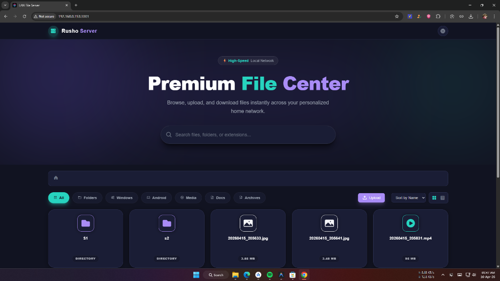

  
  
  
  

 

# 🌟 Premium LAN File & Media Server

A high-speed, fully responsive LAN file server that turns your computer into a premium personal cloud. Built with Node.js, Express, and a beautiful TailwindCSS glassmorphism aesthetic. It supports seamless direct downloads, massive file uploads (over 10GB!), and features a built-in media player perfectly integrated with FFmpeg to dynamically transcode dual-audio MKV & MP4 movies on the fly right to your browser!

### ✨ Key Features
- **Modern & Gorgeous UI**: A sleek, dark-themed, glassmorphic layout perfect for both glowing massive desktop displays and mobile phones.
- **Smart Wi-Fi Detection**: Just run `Start-Server.bat` and it will instantly auto-detect your LAN IP & open the browser automatically. Share the console IP with anyone on your network.
- **Advanced Video Streaming (Plyr.io)**: Watch your movies over Wi-Fi! Dynamically handles Dual-Audio (like English + Hindi) video files directly in the built-in player UI without buffering lag.
- **Lightning-Fast Zip Downloads**: Downloading a directory dynamically packages the whole folder as a high-compression Zip stream instantly. 

---

---

## 🆕 What's new in v2.0 (2026-11-18)

- **File manager** — New Folder, Rename, and Delete-to-Trash, with a Trash view (Restore / Empty Trash). Nothing is permanently deleted until you empty the trash.
- **Multi-select** — Checkboxes on every card, bulk Zip download and bulk delete from the selection toolbar.
- **Thumbnails** — Image and video cards show real thumbnails (cached, generated with FFmpeg).
- **Subtitles** — Sibling `.srt`/`.vtt` files appear as caption tracks in the player (`.srt` is converted to WebVTT on the fly).
- **Resume playback** — Videos pick up where you left off (saved every 5s).
- **Text/code preview** — `.txt`, `.md`, `.json`, `.js`, `.py` and more open in a readable preview instead of downloading.
- **Drag & drop upload** — Drop files anywhere on the file grid to upload them.
- **QR code** — Header button shows a QR code for the LAN address, so phones/TVs can join instantly.
- **Live stats strip** — Connections, uptime, downloaded/uploaded totals, and a disk-free bar, refreshed every 5s.
- **Faster zips & streaming** — Zip level 1 (was 9), proper suffix ranges, HEAD/ETag/416 handling.
- **Safer** — Fixed directory-traversal prefix bug, internal `.speed-trash`/`.speed-cache` folders are hidden, security headers added.

See [CHANGELOG.md](CHANGELOG.md) for the full list. Screenshot in `screenshots/preview.png` is from v1.x — the v2.0 UI adds the stats strip, selection toolbar, QR/Trash buttons and thumbnails on top of the same layout.

## 🆕 What's new in v2.1 (2026-11-18)

A full UI redesign — same features, modern look:

- **Glassmorphism everywhere** — frosted-glass header, cards, toolbar, stats strip, modals, toasts and selection bar, with soft blue (light) / blue-cyan (dark) glows behind the glass.
- **Two first-class themes** — a blue-white light theme and a deep navy-black dark theme, switched by the new sun/moon toggle in the header (saved, applied before first paint).
- **Thumbnails are the hero** — grid cards are dominated by a large 4:3 preview (real thumbnails for images/videos), with the filename and size/date in a slim strip below.
- **Slimmer header** — logo, centred pill search (press `Ctrl`/`⌘K` to focus), QR / Trash / theme / settings. Folder name, item count, total size and a live "LAN Active" pill replace the old hero.
- **Better states** — skeleton shimmer loading, a proper empty state, a Retry button on errors, glass toasts, upload ETA, and a floating glass selection bar.
- **Motion & access** — staggered card entrances, hover lift, `prefers-reduced-motion` support, and visible focus rings.

To rebuild the CSS after editing `src/input.css` or the HTML/JS: `npm run build:css`.

# 🌟 প্রিমিয়াম ল্যান ফাইল এবং মিডিয়া সার্ভার

একটি অতি-দ্রুত এবং রেস্পন্সিভ ল্যান ফাইল সার্ভার যা আপনার কম্পিউটারকে একটি প্রিমিয়াম পার্সোনাল ক্লাউডে পরিণত করে। এটি Node.js, Express এবং চমৎকার TailwindCSS গ্লাস-মর্ফিজম ডিজাইন দিয়ে তৈরি। এটি যেকোনো মাপের ফাইল (এমনকি ১০ জিবি বা তার বেশি!) আপলোড এবং সরাসরি ডাউনলোড সাপোর্ট করে। এতে একটি বিল্ট-ইন মিডিয়া প্লেয়ার রয়েছে যা FFmpeg-এর সাথে সংযুক্ত, যার মাধ্যমে আপনি আপনার ব্রাউজারেই সরাসরি ডুয়াল-অডিও (যেমন- হিন্দি ও ইংরেজি) MKV এবং MP4 মুভি বাফার ছাড়াই স্ট্রিম করতে পারবেন।

### ✨ মূল বৈশিষ্ট্যসমূহ
- **আধুনিক এবং অসাধারণ ডিজাইন**: একটি স্লিক, ডার্ক-থিম এবং গ্লাসমর্ফিক লেআউট, যা ডেস্কটপ এবং মোবাইল—উভয় স্ক্রিনেই ড্রামাটিক ও দারুণ দেখতে লাগে।
- **স্মার্ট ওয়াই-ফাই ডিটেকশন**: শুধু `Start-Server.bat` রান করলেই এটি স্বয়ংক্রিয়ভাবে আপনার ব্রাউজার ওপেন করবে এবং আপনার ল্যান আইপি (LAN IP) খুঁজে বের করবে। এরপর ব্যাক-কন্সোলে দেখানো সেই আইপি শেয়ার করে নেটওয়ার্কের যে কেউ কানেক্ট করতে পারবে।
- **অ্যাডভান্সড ভিডিও স্ট্রিমিং (Plyr.io)**: ওয়াই-ফাইয়ের মাধ্যমেই সরাসরি মুভি উপভোগ করুন! কোনোরকম বাফারিং ল্যাগ ছাড়াই ডুয়াল-অডিও মুভির (যেমন- হিন্দি + ইংরেজি) ল্যাঙ্গুয়েজ পরিবর্তন করা যাবে সরাসরি প্লেয়ারের ডিভ সেটিংস (Settings) আইকন থেকইে। 
- **বিদ্যুৎ-গতির জিপ (Zip) ডাউনলোড**: যেকোনো ফোল্ডারকে সরাসরি জিপ (Zip) ফরম্যাটে কয়েক সেকেন্ডের মধ্যেই ডাউনলোড করা সম্ভব।

---

## 🚀 How to Run / কিভাবে চালু করবেন

### Requirements:
- `Node.js` installed on your PC.

### Instructions:
1. Download or Clone the repository: `git clone https://github.com/rohan-rusho/speed.git`
2. Run the `Start-Server.bat` file.
3. The server will magically install everything it needs off npm, find your local IP address automatically, AND pop open your browser directly to the gorgeous interface! 🎉
4. Your friends, smart TV, or family on the same Wi-Fi can just type the `http://YOUR-IP:3001` Address seen on the black terminal!
